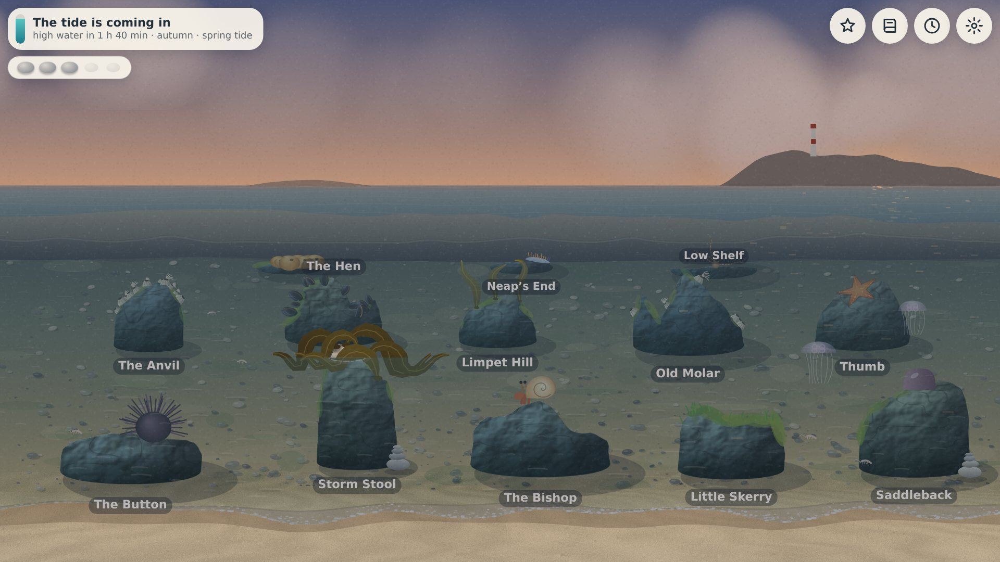

# Cairn

**A tide pool that grows while you're away, and is hurt by you coming back.**

### [▶ Play it now: cstroie.github.io/cairn](https://cstroie.github.io/cairn/)

Ten rocks. A real tide every 12 hours 25 minutes, on your own clock. Barnacles settle, kelp
grows, mussels spread. If a rock stays quiet for long enough, an anemone opens or a sea star
arrives.

You can't feed anything, plant anything or speed anything up. Every time you leave, you wade
out across the rocks and step on what lives there. **You can do one thing:** build a *cairn*, a
small stack of stones, beside a rock, and nobody will walk there. You have only a few stones.

Choose. Then go away for a while.

## What's in the pool

- **The real tide.** High and low water, spring tides at the new and full moon, neaps in
  between, seasons and weather. It's the same moment for everyone, everywhere.
- **Slow life.** Eleven kinds of life follow each other on the rocks: film, barnacles, kelp,
  mussels, anemones, urchins, sea stars, hermit crabs. When the sand uncovers the Deep Ledge,
  sponges, sea slugs and brittle stars come too.
- **A field guide to fill.** Fifty-two pages: what grows on the rocks, seals and dolphins out at
  sea, waders and a heron at dawn, what hides under the weed, the green flash at sunset, a message
  in a bottle. Each page you find uncovers another rock or washes up another stone.
- **A journal** of what happened while you were gone: storms, arrivals, losses. You can
  watch the pool's last weeks again, a day a beat, and each rock remembers how long its life
  has been there.
- **Four kinds of shore**, chosen by your pool: a northern headland, an Aegean cape, coral
  islets with palms, a rocky cove. Each has its own sand, pebbles or shingle, its own sea and
  its own sounds: cicadas, palm leaves, a foghorn, pebbles dragged by the backwash.
- **Light of the moment.** Long shadows at dusk, nets of sunlight on the floor, reflections on
  calm water, rocks shining in the rain, the Milky Way on a dark night.
- **A postcard** of your pool as it is now, and the date of the next great low water.
- **Made in code.** Every rock, wave, creature and sound is drawn or synthesized as it runs.
  There are no image or sound files.
- **Installable and offline.** A PWA for phone or desktop that updates itself. A low-water
  alert can tell you when the pool is uncovered. In English and Romanian.

## Its sibling

Cairn is the web sister of **[TIDEPOOL](https://github.com/cstroie/tidepool)**, an idle game
written in Z80 assembly for CP/M 2.2, which lives on the shelf of
[DigitalRerun](https://github.com/cstroie/digital-rerun). Both use the same tide clock and the
same rules of succession. Open both, and they show the same water.

## Under the hood

Vanilla ES modules, Canvas 2D and WebAudio. No framework, no build step, no dependencies.

    node tools/serve.js     the app on http://localhost:8125
    node --test             the tests (Node 22)
    node tools/stamp.js     after any change to the app: the build stamp in js/version.js

How to play: [docs/PLAYING.md](docs/PLAYING.md) · How it works: [docs/DESIGN.md](docs/DESIGN.md)

Until November 2026 the game was called *Low Water*. Pools saved under that name carry on.

MIT licence.
